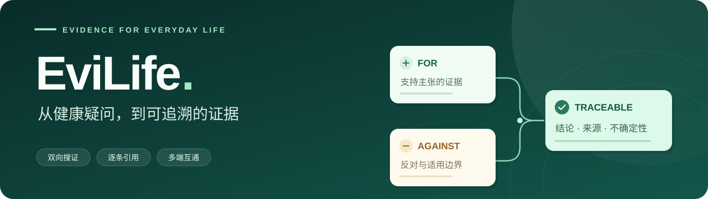
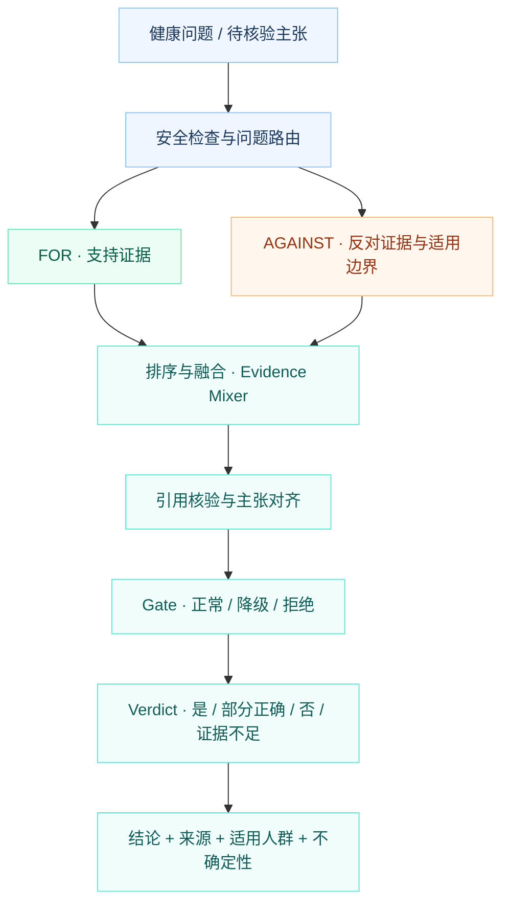

<div align="center">



# EviLife · 循证健康平台

**让健康问题有易懂的答案，让每一个结论有可追溯的依据。**

生活版读懂健康，专业版审视证据。问答、报告、日常记录与设备数据，在同一账号下连接起来。


[项目亮点](#highlights) · [双模式](#modes) · [循证流程](#evidence) · [快速上手](#quick-start) · [原生客户端](#clients) · [开发与部署](#development)

</div>

---

<a id="highlights"></a>

## ✨ 从一个问题，连接完整的健康记录

EviLife 由 **Next.js 网页端 + FastAPI 后端 + 原生移动客户端** 组成。它把健康问答拆解成结论、证据、适用人群与不确定性，再用可展开的卡片呈现。

| 能力 | 你可以做什么 |
| :--- | :--- |
| 🔎 **循证问答** | 输入健康问题，查看支持证据、反对证据与适用边界，并沿引用链接回到来源。 |
| ⚖️ **主张级裁决** | 把一条健康主张呈现为「是 / 部分正确 / 否 / 证据不足」，同时说明理由和局限。 |
| 📄 **报告解读** | 上传 PDF、TXT、CSV 或报告图片，整理指标与摘要，回看历史报告。 |
| 🥗 **餐食与日常记录** | 识别餐食图片、估算热量区间；确认后保存记录，配合进食间隔计时与今日摘要。 |
| 💚 **健康档案** | 记录饮水、步数、睡眠、体重、腰围、静息心率与心情，汇总查看个人健康信息。 |
| 📱 **多端互通** | 网页与移动端通过同一后端访问账号、对话和记录；支持扫码配对及设备健康数据接入。 |

**可以从这些问题开始：**

> 「咖啡到底健康不健康？请用大白话解释」  
> 「地中海饮食对心血管风险有什么证据？」  
> 「16:8 一定能减肥吗？」

图片识别需要配置独立视觉服务；各平台的健康数据接入状态见[原生客户端](#clients)。

<a id="modes"></a>

## 🌓 同一个问题，两种阅读方式

| | 生活版 | 专业版 |
| :--- | :--- | :--- |
| **阅读目标** | 快速理解问题，先读核心结论 | 检查主张依据，比较证据与局限 |
| **表达方式** | 易懂语言、简洁解释、分层展开 | 双向检索、证据分级、主张级引用 |
| **关注重点** | 这是什么意思，和日常生活有什么关系 | 哪些研究支持，哪些研究反对，能否外推 |
| **共同底线** | 可追溯来源、适用边界、不确定性 | 可追溯来源、适用边界、不确定性 |

专业版用于深入阅读健康证据，诊断、停换药、药物剂量等个体医疗决策仍受到安全边界限制。

<a id="evidence"></a>

## 🔬 一个结论是怎样形成的？

EviLife 的核心是 **双向独立搜证**：既寻找支持主张的材料，也寻找反对、冲突和适用范围限制，再进行排序、融合、引用核验与规则裁决。



| 证据通道 | 提供什么 |
| :--- | :--- |
| **预编译 Evidence Packet** | 仓库内已整理的主题、主张、来源与适用边界。 |
| **离线权威语料库** | SQLite 中的审核主张、可追溯来源与分级文献记录。 |
| **Europe PMC 实时检索** | 在启用网络检索时补充候选研究，分别进行支持与反对方向的查询。 |

**适用范围限制不等于直接反证；没有找到证据，也不等于主张为假。** 界面会分别展示结论强度与不确定性。Gate 控制回答能否输出，Verdict 判断当前主张的证据状态。

实现细节见 [循证引擎与安全边界](./docs/EVIDENCE_ENGINE.md)。

<a id="quick-start"></a>

## 🚀 快速上手

| 你想先做什么 | 推荐入口 | 需要什么 |
| :--- | :--- | :--- |
| 看界面、体验示例问答 | **A · 前端演示** | Node.js 与 npm，无需后端或 API Key |
| 使用真实账号、记录和证据管线 | **B · 完整本地运行** | Node.js、npm、Python 3.12+；AI 与视觉服务按需配置 |

### A · 先体验前端演示

```bash
git clone https://github.com/Oookla28/evilife.git
cd evilife
npm ci
```

创建 `.env.local`，填入：

```dotenv
NEXT_PUBLIC_API_BASE_URL=
NEXT_PUBLIC_USE_MOCKS=true
```

```bash
npm run dev
```

打开 **[localhost:3000](http://localhost:3000)**。开发模式下，演示使用 MSW 模拟问答、事件流和部分日常记录接口，适合浏览卡片与交互；账号、历史、报告分析和跨设备同步需要真实后端。示例内容不代表实时检索结果，模拟记录不作为服务端持久化数据。

### B · 完整本地运行

使用上面克隆的仓库，在**仓库根目录**操作。可使用 Node.js 22+ 与 Python 3.12+，Python 依赖安装在独立虚拟环境中。

**1. 启动后端 · macOS / Linux**

```bash
python3 -m venv backend/.venv
backend/.venv/bin/python -m pip install -r backend/requirements.txt
cp backend/.env.example backend/.env
backend/.venv/bin/python data/authoritative_health/build_database.py
backend/.venv/bin/python -m uvicorn app.main:app --app-dir backend \
  --env-file backend/.env --host 127.0.0.1 --port 8000 --reload
```

<details>
<summary><strong>Windows PowerShell 命令</strong></summary>

```powershell
py -3.12 -m venv backend\.venv
backend\.venv\Scripts\python.exe -m pip install -r backend\requirements.txt
Copy-Item backend\.env.example backend\.env
backend\.venv\Scripts\python.exe data\authoritative_health\build_database.py
backend\.venv\Scripts\python.exe -m uvicorn app.main:app --app-dir backend --env-file backend\.env --host 127.0.0.1 --port 8000 --reload
```

已安装其他兼容 Python 版本时，将 `py -3.12` 替换为对应的解释器。

</details>

**2. 新开一个终端，启动前端**

将根目录的 `.env.example` 复制为 `.env.local`；如果刚体验过演示，请覆盖演示配置，确保 `NEXT_PUBLIC_USE_MOCKS=false`。

```bash
# macOS / Linux
cp .env.example .env.local

# Windows PowerShell 使用：Copy-Item .env.example .env.local
npm ci
npm run dev
```

**3. 打开页面并注册账号**

- 网页：**[localhost:3000](http://localhost:3000)**
- 后端状态：**[127.0.0.1:8000/api/v1/health](http://127.0.0.1:8000/api/v1/health)**，应返回 `status: "ok"`。
- API 文档：**[127.0.0.1:8000/docs](http://127.0.0.1:8000/docs)**

`backend/.env.example` 默认开启 `EVILIFE_AUTH_REQUIRED=true`，真实问答和个人记录需先注册、登录。前端默认由 Next.js 将同源 `/api/v1/*` 请求转发到 `BACKEND_ORIGIN`。

### 按需启用 AI 与视觉功能

在 `backend/.env` 中配置。修改后重启后端；前端环境变量修改后重启前端。

| 功能 | 配置 | 未配置时 |
| :--- | :--- | :--- |
| **本地循证问答** | 生成权威语料库；保留仓库内 Evidence Packet | 不需要模型密钥；可在已有主题与本地语料覆盖范围内返回证据回答。 |
| **AI 文本回答** | `DEEPSEEK_API_KEY`；模型使用 `EVILIFE_AI_FAST_MODEL` / `EVILIFE_AI_DEEP_MODEL` | 不调用文本模型，回答范围取决于现有证据。 |
| **餐食与报告图片** | `EVILIFE_VISION_API_KEY` + `EVILIFE_VISION_BASE_URL` + `EVILIFE_AI_VISION_MODEL` | 不执行真实视觉识别，显示服务未配置或降级提示。 |
| **实时文献补充** | `EVILIFE_LIVE_SEARCH_ENABLED=true`，并可访问 Europe PMC | 关闭时使用本地证据；离线体验可设为 `false`。 |

视觉功能使用**独立的 OpenAI-compatible 视觉端点**。当前视觉调用还依赖启用 AI 并配置文本模型密钥，以初始化服务提供器；填写文本模型密钥不会自动启用图片识别。

<details>
<summary><strong>环境变量速查</strong></summary>

| 文件 | 变量 | 用途 |
| :--- | :--- | :--- |
| `.env.local` | `BACKEND_ORIGIN` | Next.js 服务端转发目标，默认 `http://127.0.0.1:8000`。 |
| `.env.local` | `NEXT_PUBLIC_API_BASE_URL` | 浏览器 API 基址；默认留空，使用同源请求。 |
| `.env.local` | `NEXT_PUBLIC_USE_MOCKS` | `true` 启用前端演示；真实后端使用 `false`。 |
| `backend/.env` | `EVILIFE_AI_ENABLED` | 是否启用 AI，默认 `true`，同时需要密钥。 |
| `backend/.env` | `DEEPSEEK_API_KEY` | DeepSeek 文本模型密钥。 |
| `backend/.env` | `EVILIFE_AI_BASE_URL` | 文本模型的 OpenAI-compatible 服务地址。 |
| `backend/.env` | `EVILIFE_AI_FAST_MODEL` / `EVILIFE_AI_DEEP_MODEL` | 快速 / 深度模型名称，以示例配置和供应商实际可用模型为准。 |
| `backend/.env` | `EVILIFE_VISION_API_KEY` / `EVILIFE_VISION_BASE_URL` / `EVILIFE_AI_VISION_MODEL` | 独立视觉服务的密钥、地址和模型。 |
| `backend/.env` | `EVILIFE_RUNTIME_DB` | 用户、会话、对话与健康记录的 SQLite 运行库路径。 |
| `backend/.env` | `EVILIFE_CORPUS_DB` | 只读证据库路径；留空时自动发现仓库内数据库。 |
| `backend/.env` | `EVILIFE_AUTH_REQUIRED` | 是否要求登录；示例配置为 `true`。 |
| `backend/.env` | `EVILIFE_ALLOWED_ORIGINS` | 允许访问后端的前端来源。 |

完整配置见 [前端示例](./.env.example) 与 [后端示例](./backend/.env.example)。API Key 仅放在后端或部署平台环境变量中。

</details>

<a id="clients"></a>

## 📱 一个后端，多个客户端

账号、会话、历史对话、报告结果与生活记录由 FastAPI 统一管理。设备健康数据需要对应平台授权后导入；网页登录 Apple 账号不会直接获得 HealthKit 数据权限。

| 平台 | 技术与运行要求 | 当前入口与接入方式 |
| :--- | :--- | :--- |
| **Web** | Next.js 16 · React 19 · TypeScript | 双模式问答、报告、健康档案、历史记录；支持 Apple 健康 XML 导入。 |
| **iOS** | SwiftUI · iOS 17+ · Xcode 16+ | 原生问答与 SSE、报告和记录；HealthKit 授权后聚合上传。[运行说明](./ios/README.md) |
| **Android** | Kotlin · Jetpack Compose · JDK 17 · SDK 35 | 原生问答、报告和记录；Health Connect 授权与扫码配对。[构建说明](./android/EviLifeAndroid/README.md) |
| **HarmonyOS** | ArkTS · ArkUI · HarmonyOS 6 / API 20 | 登录、问答、扫码配对与服务器配置；Health Kit 仍需开通 AGC 服务并安装 SDK。[工程说明](./harmony/README.md) |

移动端连接同一后端地址即可访问对应账号的数据。网页配对入口为 `/pairing-qr.html`；真机连接需使用手机可访问的服务器地址。

<a id="development"></a>

## 🛠️ 开发与部署

### 项目结构

```text
evilife/
├── app/                      # Next.js 页面与布局
├── components/               # 输入、模块卡片与健康界面
├── lib/                      # API 客户端、契约适配与会话状态
├── mocks/                    # MSW 演示接口
├── backend/app/              # FastAPI、编排、循证引擎与运行数据
├── backend/tests/            # 后端测试
├── data/evidence/            # 预编译 Evidence Packet
├── data/authoritative_health/ # SQLite 证据库与构建脚本
├── contracts/                # JSON Schema 契约
├── ios/                      # SwiftUI iPhone 客户端
├── android/EviLifeAndroid/   # Kotlin / Compose 客户端
├── harmony/EviLifeHarmony/   # ArkTS / ArkUI 客户端
├── tests/                    # 前端单元与 Playwright 场景
└── docs/                     # 引擎说明、设计与审计资料
```

### 本地检查

```bash
npm run lint
npm test
npm run build
backend/.venv/bin/python -m pytest backend/tests
```

Windows 将最后一行的解释器替换为 `backend\.venv\Scripts\python.exe`。更多端到端场景见 [`tests/e2e/`](./tests/e2e/)。

### 部署入口

仓库提供 [后端 Dockerfile](./backend/Dockerfile) 和 [Render Blueprint](./render.yaml)。推荐组合为 **Vercel 前端 + Render 后端 + 持久卷 SQLite**，具体配置见 [DEPLOYMENT.md](./DEPLOYMENT.md)。

SQLite 运行库需要持久化存储并保持单实例；多实例部署需先调整数据库与文件存储方案。

### 继续阅读

| 文档 | 内容 |
| :--- | :--- |
| [循证引擎与安全边界](./docs/EVIDENCE_ENGINE.md) | 双向搜证、证据融合、引用校验、Gate 与 Verdict。 |
| [部署指南](./DEPLOYMENT.md) | 前后端部署、持久化与上线验收。 |
| [证据库结构](./data/authoritative_health/DATABASE_SCHEMA_V2.md) | 数据表、来源与主张的组织方式。 |
| [引擎设计](./docs/EVIDENCE_ENGINE_2_SPEC.md) · [审计记录](./docs/EVIDENCE_ENGINE_2_AUDIT.md) | 更深入的管线设计与实现核查。 |
| [第三方归属](./THIRD_PARTY_NOTICES.md) | 适配内容、参考项目与许可说明。 |

---

EviLife 提供健康信息整理与证据阅读支持，不构成诊断或治疗建议。结论受当前语料、检索结果与适用人群限制，证据不足时会明确呈现不确定性。
